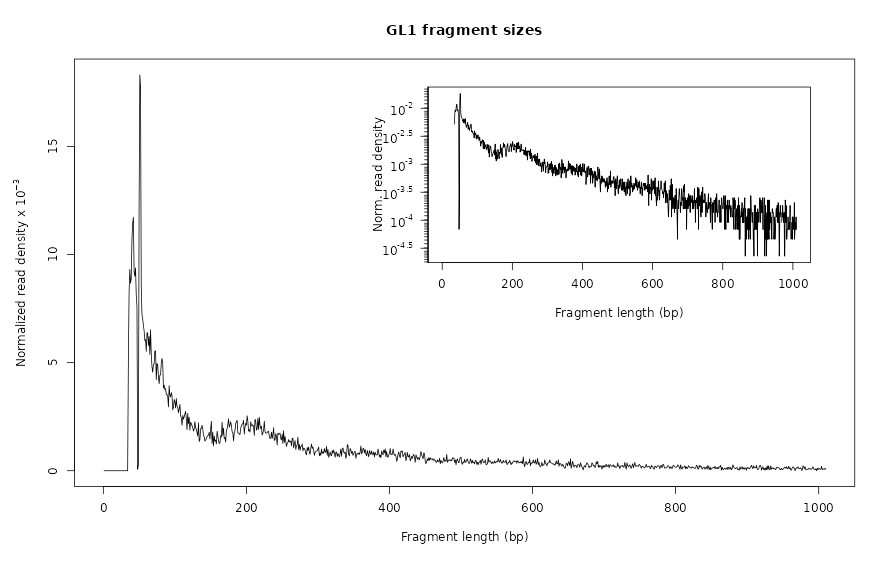
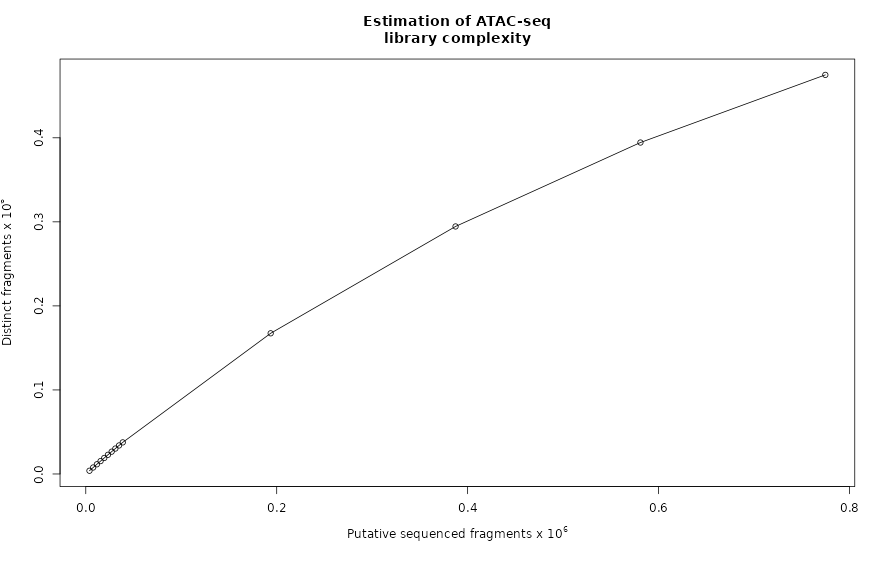
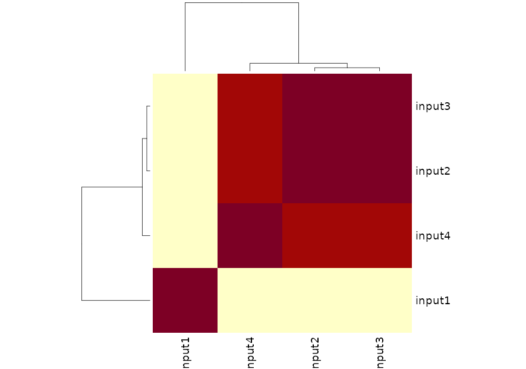
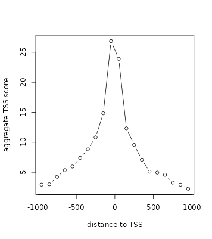
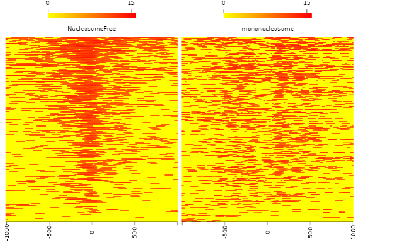
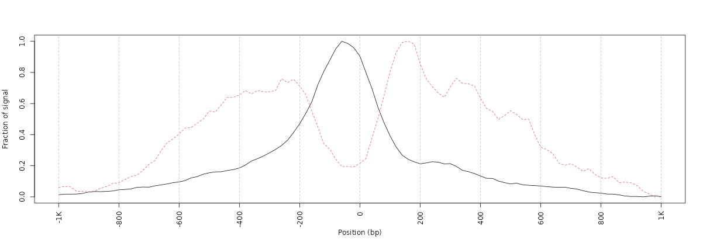

<h3>Quality control of ATAC-seq alignments</h3>

Load the aligned reads of an ATAC-seq experiment and check whether the libraries are good: fragment sizes, library complexity, signal at transcription start sites and nucleosome patterns. No R programming is needed.

The analysis is run by the Bioconductor <a href="https://bioconductor.org/packages/release/bioc/html/ATACseqQC.html" target="_blank">ATACseqQC</a> package.

<h3>How it works</h3>

Each step appears in the sidebar when the one before it has finished.

<h4>1Input data</h4>
Upload BAM files with their index files, or start from the example data.

<h4>2Reference genome</h4>
Choose the genome the reads were aligned to and press Initialize QC.

<h4>3First look</h4>
The Heatmap, Library Complexity and Fragment size tabs are ready straight away.

<h4>4Core QC</h4>
Pick a sample and a chromosome and run the core QC for the scores at transcription start sites.

<h4>5Go deeper</h4>
With the core QC done, run the nucleosome profiles and the transcription-factor footprinting.

<h3>What you get</h3>

Figures from the example data. Click a figure to enlarge it.

<figure class="guide-figure"><figcaption><strong>Fragment sizes</strong> A good library shows nucleosome-free fragments and a ladder of one, two and more nucleosomes.</figcaption></figure>
<figure class="guide-figure"><figcaption><strong>Library complexity</strong> How many distinct fragments the library holds, and how many more deeper sequencing would add.</figcaption></figure>
<figure class="guide-figure"><figcaption><strong>Sample heatmap</strong> How similar the samples are to each other on the chromosome you choose.</figcaption></figure>
<figure class="guide-figure"><figcaption><strong>TSS enrichment</strong> Cut-site signal piled up around transcription start sites.</figcaption></figure>
<figure class="guide-figure"><figcaption><strong>TSS-aligned heatmap</strong> Signal of each fragment class across transcription start sites.</figcaption></figure>
<figure class="guide-figure"><figcaption><strong>Nucleosome signal</strong> Nucleosome-free and nucleosome-bound coverage around transcription start sites.</figcaption></figure>

The Core QC tab also gives the promoter to transcript body score and the nucleosome-free region score. Every figure downloads as PNG, PDF or SVG.

<h3>Preparing your files</h3>
<ul>
<li>Aligned reads as BAM files, coordinate-sorted, each with its BAI index.</li>
<li><strong>Every BAM file needs an index file with the same name</strong>, for example <code>sample1.bam</code> and <code>sample1.bai</code>. Upload both together.</li>
<li><strong>The reference genomes offered are the ones installed on this instance.</strong> The reads must have been aligned to one of them.</li>
<li><strong>The sample heatmap needs more than one BAM file.</strong></li>
</ul>

<h3>The analyses</h3>
<ul>
<li><strong>Heatmap, Library Complexity, Fragment size.</strong> Available as soon as the QC is initialized. Choose the sample, or the chromosome for the heatmap, at the top of each tab.</li>
<li><strong>Core QC.</strong> Choose a sample and a chromosome and press <em>Run core QC</em>. You get the promoter to transcript body score, the nucleosome-free region score and the TSS enrichment score.</li>
<li><strong>Nucleosome Profiles.</strong> Press <em>Run nucleosome analysis</em> for the cumulative tag allocation, the TSS-aligned heatmap and the nucleosome-free and nucleosome-bound distributions. The reads split by fragment class can be downloaded as BAM files.</li>
<li><strong>TF Footprinting.</strong> Enter a motif name, CTCF by default, and press <em>Run footprint analysis</em> for the footprint of that factor and a heatmap of its binding sites.</li>
<li><strong>Nucleosome Profiles and TF Footprinting use the sample and chromosome of the core QC</strong>, so run the core QC first.</li>
</ul>

<h3>On a private instance</h3>

NASQAR2 can also run as a private instance on your own server or cluster, where your data stays on your own machines. Everything above works the same way there. In addition:

<ul>
<li><strong>BAM files need no upload.</strong> Choose <strong>BAM folder in the private space</strong>, press <strong>Browse folder</strong> to pick a folder that is already on the server, then <strong>Load folder</strong>.</li>
<li><strong>Your work is saved automatically</strong> in the project chosen at the top of the input step, for runs that start from a BAM folder in the private space.</li>
<li><strong>Every analysis belongs to a project.</strong> The <strong>Project</strong> question at the top of the input step asks whether to <strong>create a new project</strong> or <strong>open an existing one</strong>. All applications of one study save into the same project, each in its own folder.</li>
<li><strong>You can continue later.</strong> Choose <strong>Open an existing project</strong>, pick the project and press <strong>Continue</strong>. The folder and the reference genome come back, and results already computed are not computed again.</li>
<li><strong>Your figures are kept together</strong> on the <strong>Project files</strong> page. <strong>Save all to project</strong> stores all of them in one click.</li>
</ul>

These options do not appear on the public site.

<h3>Citation</h3>

Ou J, Liu H, Yu J, et al. ATACseqQC: a Bioconductor package for post-alignment quality assessment of ATAC-seq data. <em>BMC Genomics</em> 19, 169 (2018). <a href="https://doi.org/10.1186/s12864-018-4559-3" target="_blank">https://doi.org/10.1186/s12864-018-4559-3</a>

<button type="button" class="close" data-dismiss="modal">&times;Close</button>

