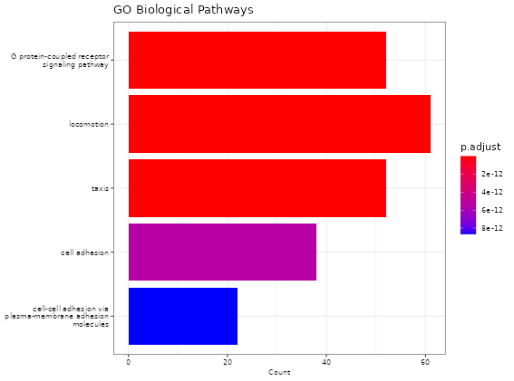
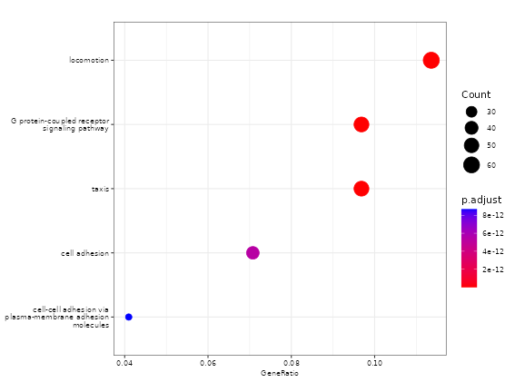
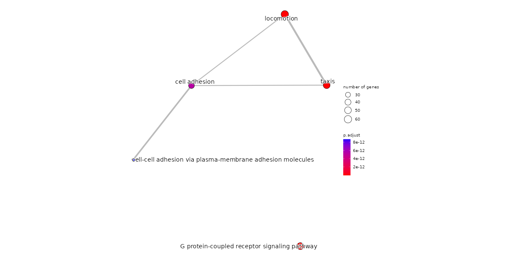
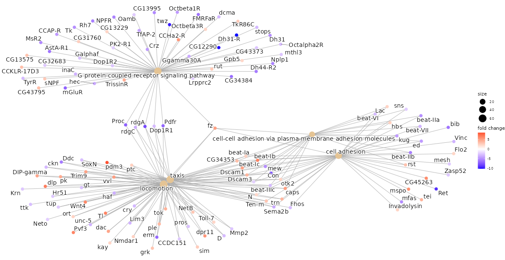
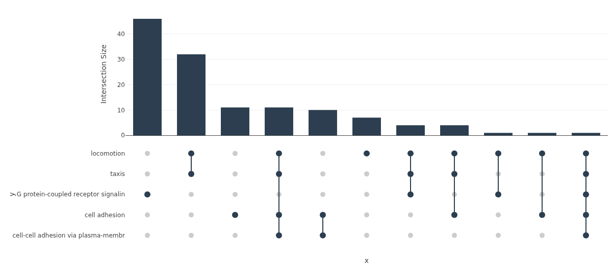
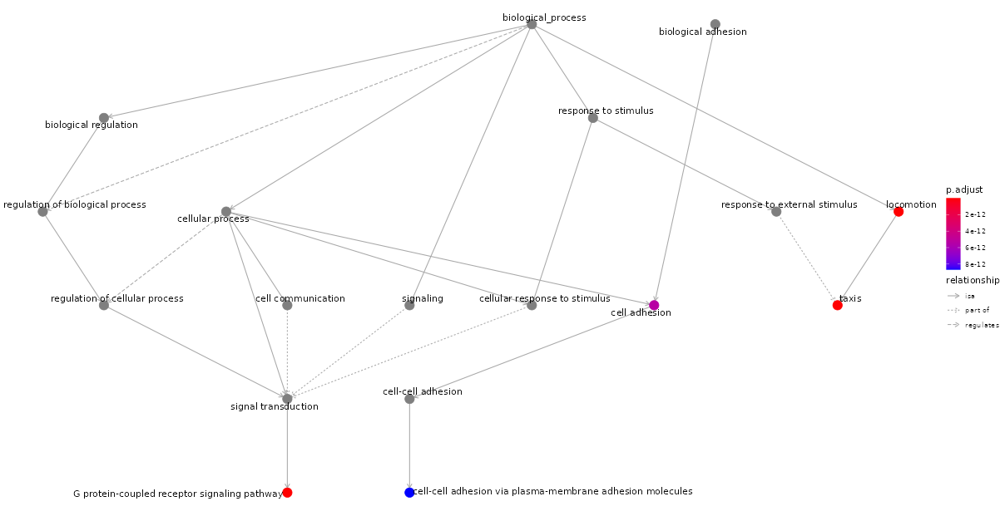
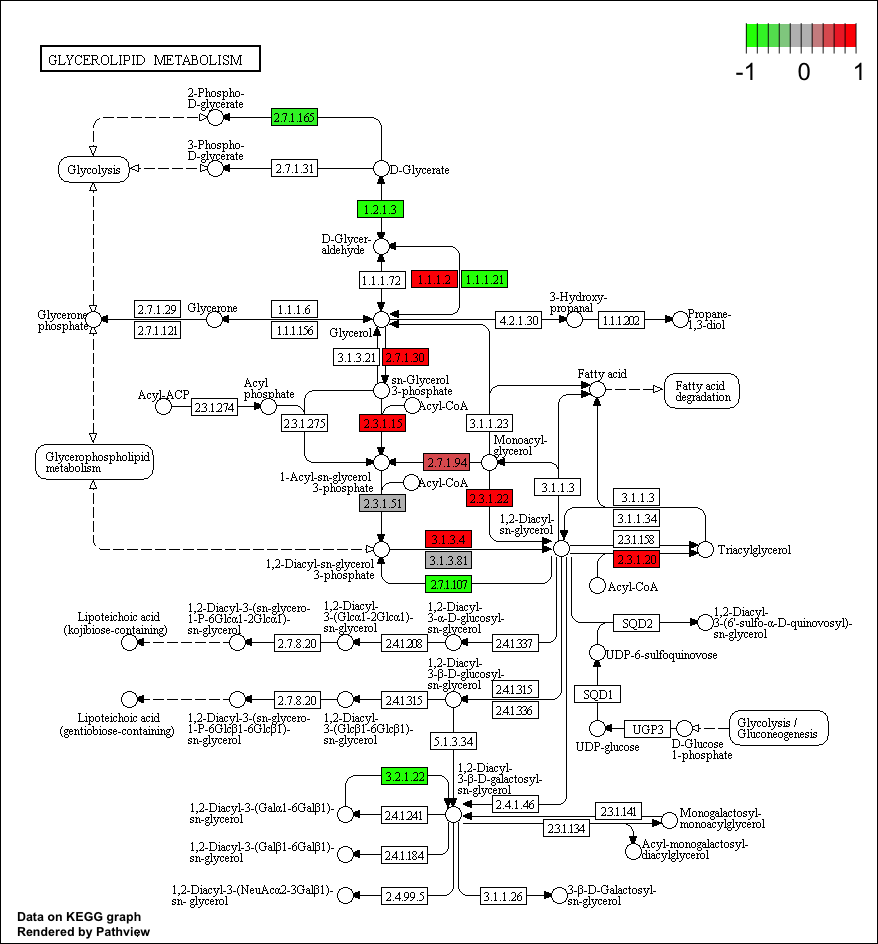
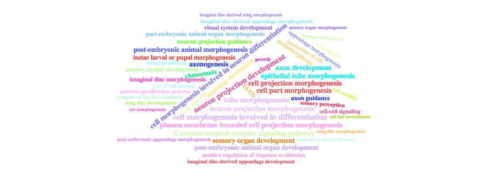
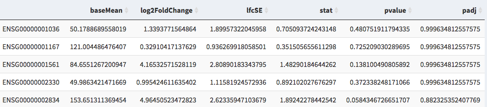

<h3>Over-representation analysis of GO terms and KEGG pathways</h3>

Start from a table of differential expression results, pick the significant genes, and find the GO terms and KEGG pathways they are enriched in. No R programming is needed.

The analysis is run by <a href="https://bioconductor.org/packages/release/bioc/html/clusterProfiler.html" target="_blank">clusterProfiler</a>. It asks whether your gene list contains more genes of a term than expected by chance, so the result depends on the cutoffs you choose in step 2.

<h3>How it works</h3>

The result tabs appear in the sidebar once the enrichment has run.

<h4>1Input data</h4>
Upload a results table, start from the example data, or arrive from DESeq2 Shiny with a comparison already loaded.

<h4>2Select genes</h4>
Choose the gene, log2 fold change and padj columns, then the padj cutoff and the minimum absolute log2 fold change. Optionally restrict to your own gene list.

<h4>3Enrichment parameters</h4>
Choose the organism, the key type of your gene identifiers and the ontology, then create the enrichGO object.

<h4>4Explore</h4>
Browse the enrichGO and enrichKEGG tables, plot the terms you care about, and download tables and figures.

<h3>What you get</h3>

Figures from the example data. Click a figure to enlarge it.

<figure class="guide-figure"><figcaption><strong>Bar plot</strong> Enriched terms ranked by significance.</figcaption></figure>
<figure class="guide-figure"><figcaption><strong>Dot plot</strong> Gene ratio, gene count and significance in one view.</figcaption></figure>
<figure class="guide-figure"><figcaption><strong>Enrichment map</strong> Terms linked when their gene sets overlap.</figcaption></figure>
<figure class="guide-figure"><figcaption><strong>Category-gene network</strong> Terms and the genes that drive them, coloured by fold change.</figcaption></figure>
<figure class="guide-figure"><figcaption><strong>Gene membership</strong> Which genes the displayed terms share. Click a bar to list them.</figcaption></figure>
<figure class="guide-figure"><figcaption><strong>GO induced graph</strong> The enriched terms in the GO hierarchy (GO only).</figcaption></figure>
<figure class="guide-figure"><figcaption><strong>Pathview</strong> Your fold changes drawn onto a KEGG pathway map.</figcaption></figure>
<figure class="guide-figure"><figcaption><strong>Word cloud</strong> The words that recur in the enriched term names.</figcaption></figure>

The KEGG Plots tab offers the same plots for KEGG pathways. The enrichGO and enrichKEGG tables can be downloaded as well.

<h3>Preparing your results table</h3>
<ul>
<li>A plain-text table, comma or tab delimited (.csv or .txt), with a header row and one gene per row.</li>
<li>A gene identifier column: ENSEMBL, SYMBOL, ENTREZID or another type you can choose as the key type in step 3. The unnamed first column that DESeq2 writes is accepted.</li>
<li>A numeric log2 fold change column and an adjusted p-value (padj) column, used to pick the significant genes.</li>
<li>Other columns, such as baseMean or pvalue, are allowed and ignored.</li>
</ul>

<figure class="guide-figure guide-table"><figcaption><strong>Example table</strong> A differential expression table as written by DESeq2.</figcaption></figure>

Coming from DESeq2 Shiny? The enrichment buttons under its results table open this app with that comparison already loaded, so there is nothing to upload.

<h3>Choosing the terms to plot</h3>

The plot tabs show the top terms by default. To plot specific ones, select their rows in the enrichGO or enrichKEGG results table first; the plot tabs then use your selection. On the plot tabs, the interactive gene membership chart shows which genes the displayed terms share: click a bar to list its genes.

<h3>Good to know</h3>
<ul>
<li>The organisms offered are the annotation databases installed on this instance.</li>
<li>KEGG analysis uses NCBI Gene IDs; the app converts your identifiers from the key type you chose.</li>
<li>With the ontology set to ALL, the three GO ontologies are analysed together.</li>
<li><em>Simplify GO results</em> removes redundant GO terms that are very similar to a more significant one.</li>
</ul>

The app follows this <a href="https://learn.gencore.bio.nyu.edu/rna-seq-analysis/over-representation-analysis/" target="_blank">over-representation analysis tutorial</a>.

<button type="button" class="close" data-dismiss="modal">&times;Close</button>

