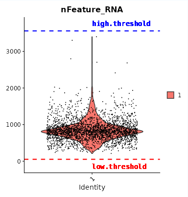
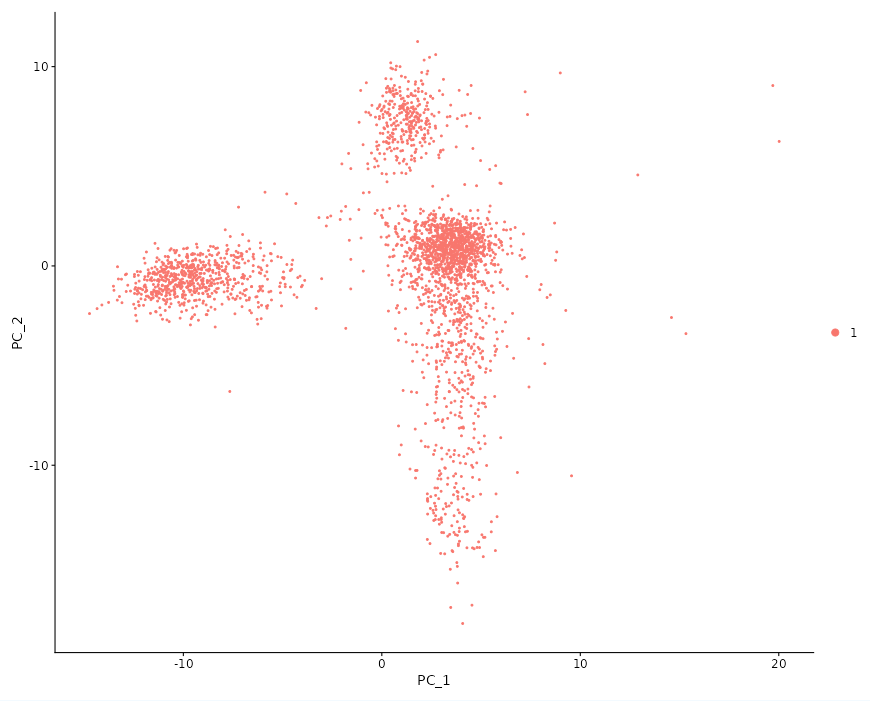
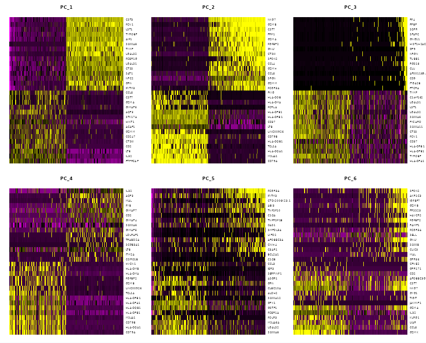
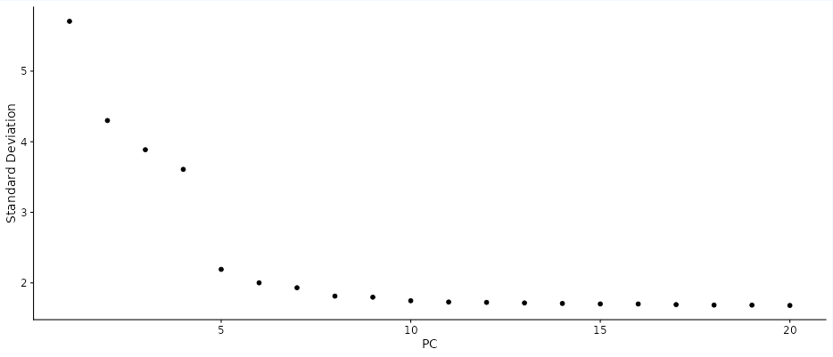
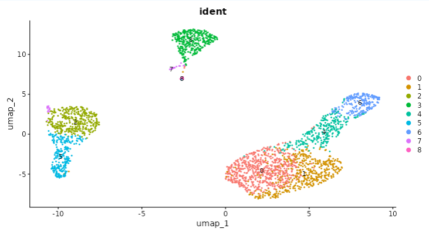

<h3>Guided single-cell RNA-seq analysis and clustering</h3>

Load the counts of a single-cell experiment and go step by step from quality control to clusters and their marker genes. You can go back to any step, change a setting and see the effect. No R programming is needed.

The analysis is run by <a href="https://satijalab.org/seurat/" target="_blank">Seurat</a> and follows its guided clustering tutorial.

<h3>How it works</h3>

Each step appears in the sidebar when the one before it has finished.

<h4>1Input data</h4>
Upload a count matrix or 10X files, or start from the example data. Set the minimum cells per gene and genes per cell.

<h4>2QC and filter</h4>
Flag gene sets such as mitochondrial genes, look at the violin plots, and remove low-quality cells.

<h4>3Normalise</h4>
Normalise, find the variable genes and scale the data, or use SCTransform for all three.

<h4>4PCA</h4>
Run the PCA, inspect the components, and use the elbow plot to decide how many to keep.

<h4>5Cluster</h4>
Cluster the cells and lay them out with UMAP or t-SNE.

<h4>6Markers and export</h4>
Find the marker genes of each cluster, plot them, and download the Seurat object or an R script of your steps.

<h3>What you get</h3>

Figures from the example data, about 2,700 blood cells. Click a figure to enlarge it.

<figure class="guide-figure"><figcaption><strong>QC violin plots</strong> Genes and counts per cell, used to choose the filtering limits.</figcaption></figure>
<figure class="guide-figure"><figcaption><strong>PCA plot</strong> Cells on the first principal components.</figcaption></figure>
<figure class="guide-figure"><figcaption><strong>PC heatmap</strong> The genes that drive each principal component.</figcaption></figure>
<figure class="guide-figure"><figcaption><strong>Elbow plot</strong> How much variation each component explains, to choose how many to keep.</figcaption></figure>
<figure class="guide-figure"><figcaption><strong>UMAP</strong> The cells in two dimensions, coloured by cluster.</figcaption></figure>
<figure class="guide-figure"><figcaption><strong>Marker genes</strong> Expression of chosen genes in each cluster.</figcaption></figure>

Tables to download include the genes of each principal component, the cells of a cluster and the marker genes. Every plot has its own download button.

<h3>Preparing your data</h3>
<ul>
<li><strong>A count matrix</strong> as a CSV file, with genes in rows and cells in columns.</li>
<li><strong>10X data</strong> as its three files: one <code>.mtx.gz</code> file and two <code>.tsv.gz</code> files. <strong>Select the three files together in one upload.</strong></li>
<li><strong>An upload can be at most 400 MB in total.</strong></li>
<li>The example data is the PBMC data set of the Seurat tutorial, a quick way to see what each step expects.</li>
</ul>

<h3>Good to know</h3>
<ul>
<li>The <strong>Project name</strong> on the Input Data tab is used in the names of the files you download.</li>
<li><strong>Changing a setting in an earlier step means running the later steps again.</strong> The sidebar marks finished steps with a check mark.</li>
<li>On the Elbow/JackStraw tab the elbow plot is quick; the JackStraw test takes considerably longer.</li>
<li>On the last tab, <em>Generate Seurat Robj</em> saves the object as an <code>.rds</code> file you can load in R, and <em>Generate Seurat Script</em> gives an R script of the steps you ran. <strong>Edit the data path in the script before running it.</strong></li>
<li>With the object saved, you can open it directly in the Monocle 3 app for trajectory analysis.</li>
</ul>

<h3>On a private instance</h3>

NASQAR2 can also run as a private instance on your own server or cluster, where your data stays on your own machines. Everything above works the same way there. In addition:

<ul>
<li><strong>Large data needs no upload.</strong> Choose <strong>Data in the private space</strong>, browse to a 10X folder or a count matrix that is already on the server, and press <strong>Load data</strong>.</li>
<li><strong>Your work is saved automatically</strong> under the project name, including the Seurat object once you generate it.</li>
<li><strong>Every analysis belongs to a project.</strong> The <strong>Project</strong> question at the top of the input step asks whether to <strong>create a new project</strong> or <strong>open an existing one</strong>. All applications of one study save into the same project, each in its own folder.</li>
<li><strong>You can continue later.</strong> Choose <strong>Open an existing project</strong>, pick the project and press <strong>Continue</strong>. The data comes back and the saved Seurat object is ready to download or send to Monocle 3. <strong>Only projects made from data in the private space can be reopened.</strong></li>
<li><strong>Your figures and tables are kept together</strong> on the <strong>Project files</strong> page. <strong>Save all to project</strong> stores all of them in one click.</li>
</ul>

These options do not appear on the public site.

<h3>Citation</h3>

Hao Y, Stuart T, Kowalski MH, et al. Dictionary learning for integrative, multimodal and scalable single-cell analysis. <em>Nature Biotechnology</em> 42, 293-304 (2024). <a href="https://doi.org/10.1038/s41587-023-01767-y" target="_blank">https://doi.org/10.1038/s41587-023-01767-y</a>

<button type="button" class="close" data-dismiss="modal">&times;Close</button>

