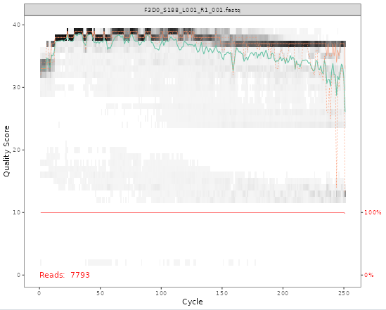
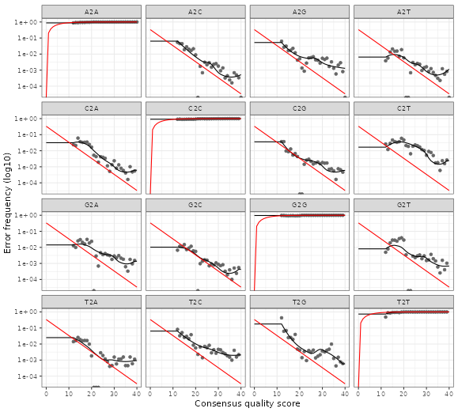
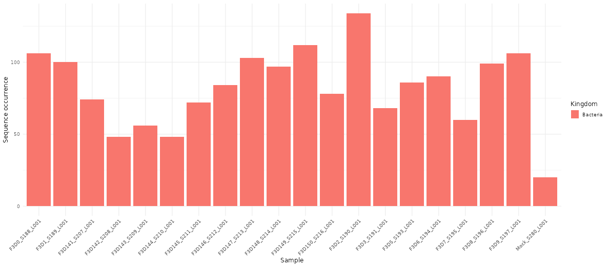
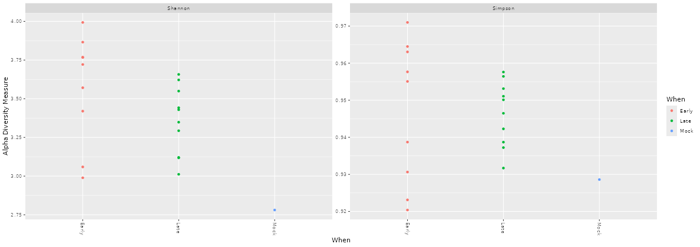
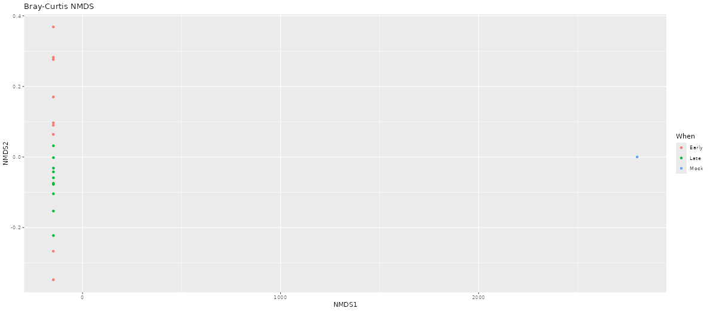
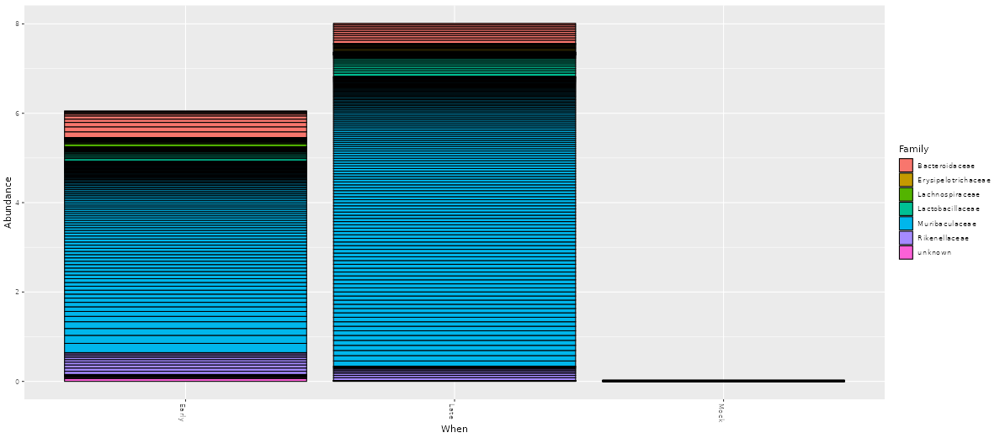

<h3>From amplicon reads to sequence variants and taxonomy</h3>

Load the FASTQ files of an amplicon sequencing run, such as 16S rRNA, and get the exact sequence variants in each sample, their taxonomy, and diversity plots. No R programming is needed.

The analysis is run by <a href="https://benjjneb.github.io/dada2/" target="_blank">DADA2</a>, which corrects sequencing errors to tell true biological sequences apart instead of grouping reads into clusters.

<h3>How it works</h3>

Each step appears in the sidebar when the one before it has finished.

<h4>1Input data</h4>
Upload FASTQ files or start from the example data, say whether the run is single-end or paired-end, and press Run QC.

<h4>2Quality profile</h4>
Look at the read quality of each sample to decide where the reads should be cut.

<h4>3Run DADA2</h4>
Set the truncation lengths and error limits. The app then filters, learns the error rates, denoises, merges read pairs and removes chimeras.

<h4>4Taxonomy</h4>
Assign each sequence variant to a taxonomy with the SILVA reference, or with a reference of your own.

<h4>5Diversity and abundance</h4>
Add a sample metadata file to compare diversity and composition between groups of samples.

<h3>What you get</h3>

Figures from the example data. Click a figure to enlarge it.

<figure class="guide-figure"><figcaption><strong>Quality profile</strong> Base quality along the read, for the forward and the reverse reads of a sample.</figcaption></figure>
<figure class="guide-figure"><figcaption><strong>Error rates</strong> How well the learned error model fits the observed errors.</figcaption></figure>
<figure class="guide-figure"><figcaption><strong>Sequence abundance</strong> How the reads of the selected sequence variants are spread over the samples.</figcaption></figure>
<figure class="guide-figure"><figcaption><strong>Alpha diversity</strong> Shannon and Simpson diversity within each sample, by group.</figcaption></figure>
<figure class="guide-figure"><figcaption><strong>Ordination</strong> Samples placed by how different their communities are (Bray-Curtis, NMDS).</figcaption></figure>
<figure class="guide-figure"><figcaption><strong>Composition</strong> Relative abundance at the taxonomy rank you choose.</figcaption></figure>

Tables to download: reads kept at every step, the sequence table, the taxonomy table (CSV and FASTA) and the denoised and chimera-free sequences. Every figure downloads as PNG, PDF or SVG.

<h3>Preparing your reads</h3>
<ul>
<li>FASTQ files, plain or gzip-compressed (<code>.fastq</code> or <code>.fastq.gz</code>), one file per sample and read direction.</li>
<li>For a paired-end run, the forward and the reverse file of a sample share the same name and differ only in their ending. Enter the two endings under <em>Read layout</em>; the default is <code>_R1_001.fastq</code> and <code>_R2_001.fastq</code>.</li>
<li><strong>Every forward file needs its reverse partner.</strong></li>
<li>Single-end runs need only the forward file ending.</li>
</ul>

<h3>Choosing the settings</h3>
<ul>
<li><strong>Truncation length.</strong> Reads are cut at this position and shorter reads are dropped. Pick the point where quality falls off in the quality profile. The defaults, 240 for forward and 160 for reverse reads, suit the example data.</li>
<li><strong>Maximum expected errors.</strong> Reads with more expected errors than this are dropped. The default is 2.</li>
<li><strong>Paired reads must still overlap after truncation</strong>, or they cannot be merged. The Track Reads tab shows how many reads survive each step, which is the quickest way to spot settings that are too strict.</li>
</ul>

<h3>Assigning taxonomy</h3>

The SILVA v138.1 reference is provided. You can upload your own reference instead, as long as it is formatted for DADA2 (see <a href="https://benjjneb.github.io/dada2/training.html" target="_blank">how to prepare a reference database</a>). Species-level assignment is optional. Select rows of the taxonomy table to plot how those sequence variants are spread over the samples.

<h3>Diversity and abundance</h3>
<ul>
<li>Upload a sample metadata file in QIIME format: tab-separated, with the sample names in a first column called <code>#SampleID</code> and one column per variable.</li>
<li><strong>The sample names must match the DADA2 sample names exactly</strong>, which are the file names without their read ending.</li>
<li>Choose the variable that groups the samples, an optional colour, and the taxonomy rank.</li>
<li>The composition plot shows <strong>the 20 most abundant sequence variants</strong>.</li>
</ul>

<h3>On a private instance</h3>

NASQAR2 can also run as a private instance on your own server or cluster, where your data stays on your own machines. Everything above works the same way there. In addition:

<ul>
<li><strong>Your work is saved automatically</strong> under the name in the <strong>Project name</strong> box on the Input Data tab.</li>
<li><strong>Large runs need no upload.</strong> Choose <strong>FASTQ folder in the private space</strong> and press <strong>Browse folder</strong> to use reads that are already on the server.</li>
<li><strong>You can continue later.</strong> Choose <strong>Reopen a saved project</strong> on the Input Data tab, pick your project and press <strong>Open project</strong>. The results come back without running the analysis again. <strong>Only projects started from a FASTQ folder in the private space can be reopened.</strong></li>
<li><strong>Your figures and tables are kept together</strong> on the <strong>Project files</strong> page. <strong>Save all to project</strong> stores all of them in one click.</li>
</ul>

These options do not appear on the public site.

<h3>Citation</h3>

<button type="button" class="close" data-dismiss="modal">&times;Close</button>

If you use this App for your analysis, please use the following citations:

1. Callahan, B., McMurdie, P., Rosen, M. et al. DADA2: High-resolution sample inference from Illumina amplicon data. Nat Methods 13, 581–583 (2016). https://doi.org/10.1038/nmeth.3869
2. NASQAR 2 :(Pending publication)
