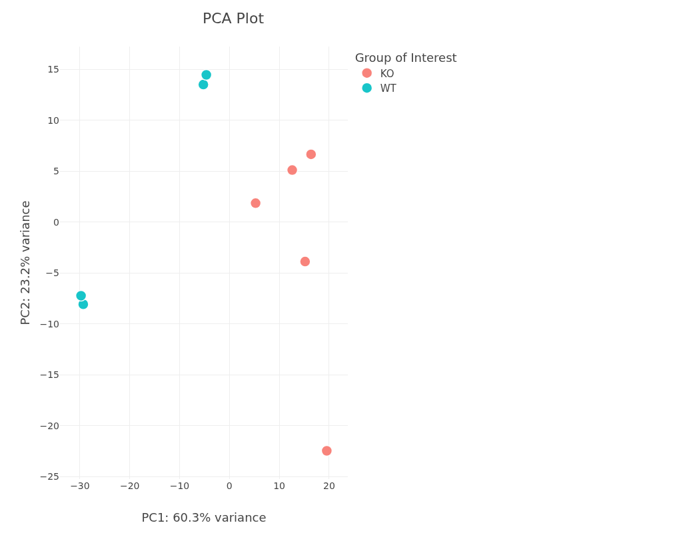
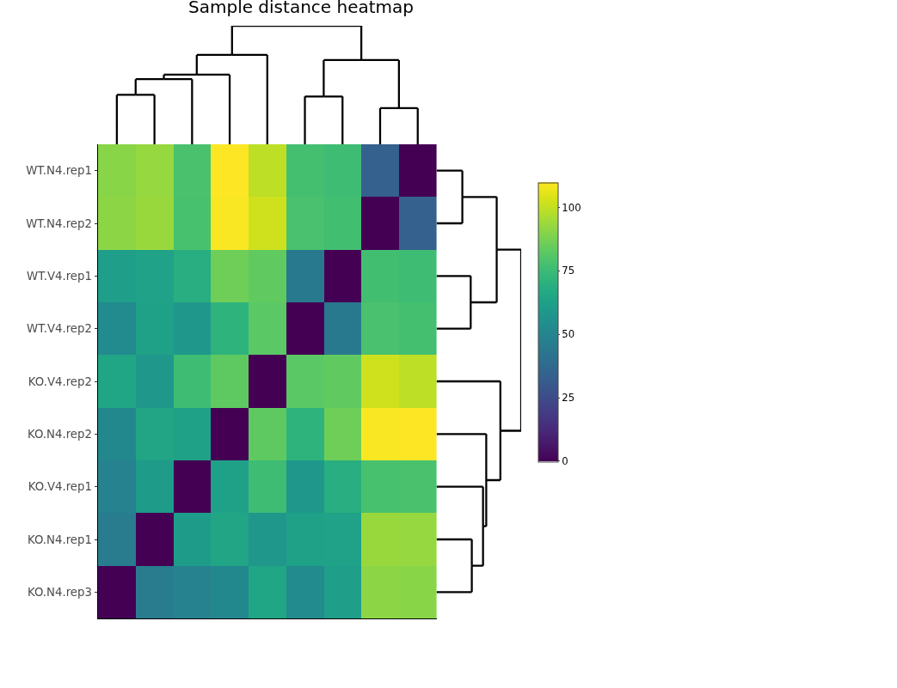
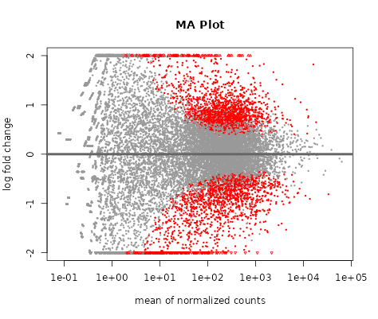
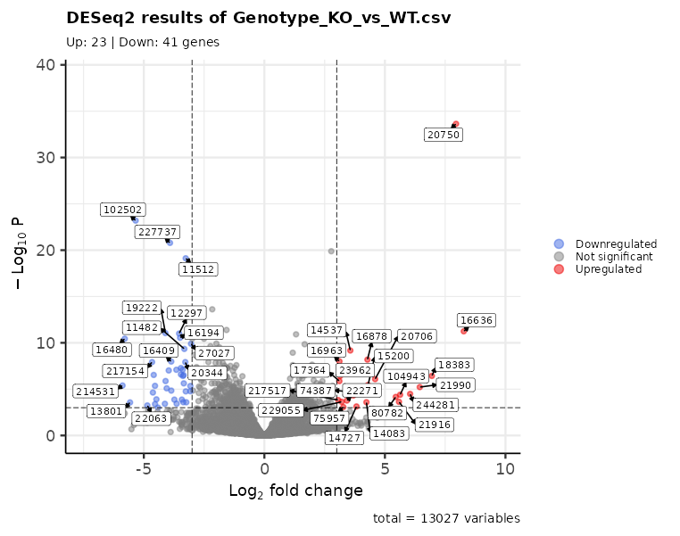
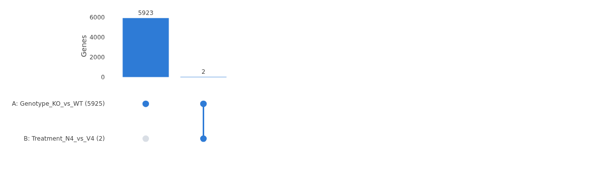
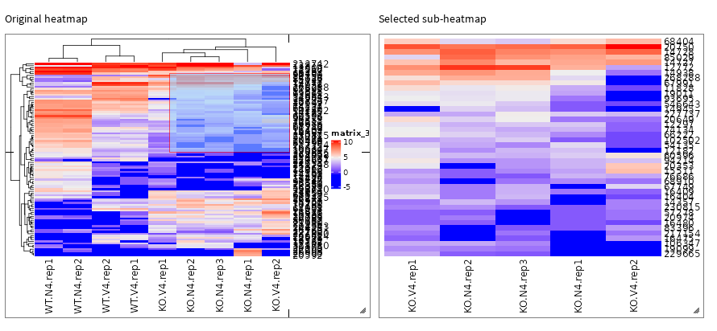
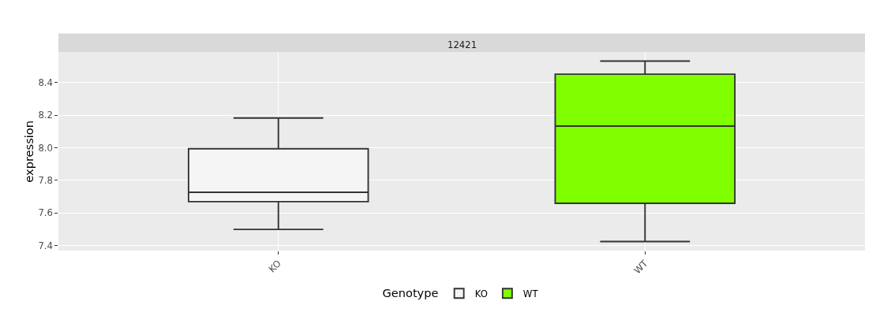
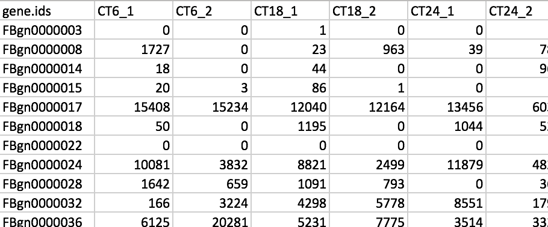
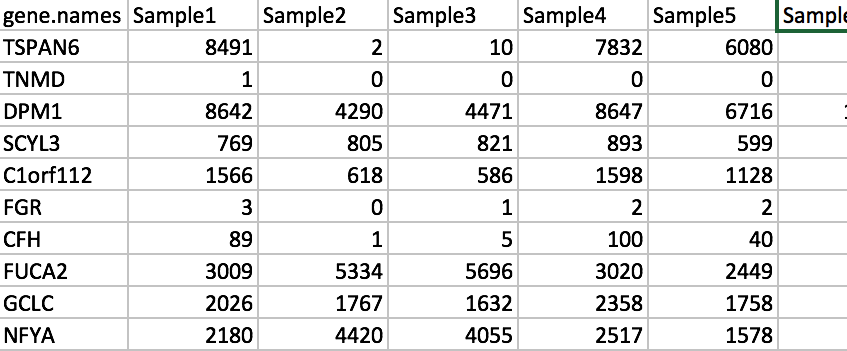
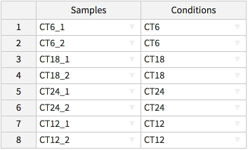

<h3>Differential expression analysis with DESeq2</h3>

Upload a table of raw RNA-seq counts, describe your samples, and explore differential expression interactively. No R programming is needed.

The analysis is run by <a href="https://bioconductor.org/packages/release/bioc/html/DESeq2.html" target="_blank">DESeq2</a>. Single-factor and multi-factor designs are supported, as is exploratory analysis without replicates.

<h3>How it works</h3>

The steps appear in the sidebar as you complete them.

<h4>1Input data</h4>
Upload a counts file or start from one of the example data sets. Optionally filter out genes with low counts.

<h4>2Design conditions</h4>
Check or edit the table that assigns each sample to its condition, and choose the design formula.

<h4>3Run DESeq2</h4>
Run the analysis. If you suspect a hidden batch effect, estimate surrogate variables first and add them to the design.

<h4>4Explore and export</h4>
Compare conditions, plot genes, and download tables and figures. Export R code reproduces every figure outside the app.

<h3>What you get</h3>

Figures from the multi-factor example data. Click a figure to enlarge it.

<figure class="guide-figure"><figcaption><strong>PCA plot</strong> Samples on the first two principal components of the VST or rlog values.</figcaption></figure>
<figure class="guide-figure"><figcaption><strong>Sample distance heatmap</strong> How similar the samples are to each other, with clustering.</figcaption></figure>
<figure class="guide-figure"><figcaption><strong>MA plot and results table</strong> Log fold change, p-value and adjusted p-value for the comparison you choose.</figcaption></figure>
<figure class="guide-figure"><figcaption><strong>Volcano plot</strong> Up- and down-regulated genes of a saved comparison, at the thresholds you set.</figcaption></figure>
<figure class="guide-figure"><figcaption><strong>UpSet plot and set operations</strong> Genes shared between comparisons, or unique to one of them.</figcaption></figure>
<figure class="guide-figure"><figcaption><strong>Interactive heatmap</strong> The most variable genes, or a set you choose. Drag over an area to zoom into it as a sub-heatmap.</figcaption></figure>
<figure class="guide-figure"><figcaption><strong>Gene boxplot</strong> Expression of individual genes across your conditions.</figcaption></figure>

The Volcano Plot and UpSet Plot tabs work on saved comparisons: press <em>mark it for further analysis</em> under the results table on the DE Results tab. The volcano plot needs one saved comparison, the UpSet plot at least two.

<h3>Comparing gene lists: UpSet plot and set operations</h3>

The UpSet Plot tab answers questions such as "which genes respond to the treatment but not to the knockout?". It compares the significant genes of the comparisons you saved, and it is not limited to a handful of them the way a Venn diagram is.

<h4>1Pick comparisons</h4>
Select two or more saved comparisons, choose all, up-regulated or down-regulated genes, set the thresholds and press <em>Plot UpSet</em>.

<h4>2Read the plot</h4>
Each bar counts the genes that are significant in exactly one combination of comparisons. The dots under a bar show which comparisons that is.

<h4>3Click a bar</h4>
The genes of that bar are listed below the plot with their fold change in every comparison, and drawn as a heatmap. Drag over the heatmap to pull out a subset.

<h4>4Go further with set operations</h4>
For a question that is not a single bar, write a set expression. Each comparison has a letter (A, B, C and so on), shown next to its name.

<table class="guide-ops">
<thead><tr><th>Operator</th><th>Meaning</th><th>Example</th><th>Genes returned</th></tr></thead>
<tbody>
<tr><td><code>*</code></td><td>Intersection</td><td><code>A*B</code></td><td>Significant in both A and B</td></tr>
<tr><td><code>+</code></td><td>Union</td><td><code>A+B</code></td><td>Significant in A, in B, or in both</td></tr>
<tr><td><code>-</code></td><td>Difference</td><td><code>A-B</code></td><td>Significant in A but not in B</td></tr>
<tr><td><code>( )</code></td><td>Grouping</td><td><code>(A*B)-C</code></td><td>Shared by A and B, but not significant in C</td></tr>
</tbody>
</table>

Expressions are read from left to right and no operator takes priority over another, so use parentheses whenever you mix operators: <code>A-(B+C)</code> is not the same as <code>A-B+C</code>. Clicking a bar fills in the expression for that bar, which is a quick way to see how they are written.

<h3>Example data</h3>

Running an example first is the quickest way to see what each step expects.

<ul>
<li><strong>Single-factor:</strong> human tissue comparison counts from <a href="https://www.ncbi.nlm.nih.gov/pubmed?term=18978772" target="_blank">this published study</a>. The samples have no replicates.</li>
<li><strong>Multi-factor:</strong> mouse counts with a sample metadata table from <a href="https://doi.org/10.1038/ni.2710" target="_blank">this published study</a>. You can download the <a href="chenCounts.csv" target="_blank">counts file</a> and the <a href="chenMeta.csv" target="_blank">metadata file</a> to see the expected layout.</li>
</ul>

<h3>Preparing your counts file</h3>
<ul>
<li>A plain-text table, comma or tab delimited (.csv or .txt), with a header row.</li>
<li>The first column holds the gene identifiers, one gene per row. It can be gene IDs or gene names.</li>
<li>A file can also carry both: gene IDs in the first column and gene symbols in the second. Choose <em>My matrix contains GeneIDs and GeneSymbols</em> on the Input Data tab, and you can then search and label genes by either.</li>
<li>Every other column is one sample of raw integer read counts. Do not use normalised values such as TPM or FPKM.</li>
<li>Use only letters, digits and underscores in sample names.</li>
<li>If each sample has its own counts file, combine them first with <a href="http://nasqar.abudhabi.nyu.edu/GeneCountMerger" target="_blank">Gene Count Merger</a>.</li>
</ul>

<figure class="guide-figure guide-table"><figcaption><strong>With replicates</strong> Name samples as condition, underscore, replicate number (CT6_1, CT6_2) and the conditions are filled in for you.</figcaption></figure>
<figure class="guide-figure guide-table"><figcaption><strong>Without replicates</strong> Tick <em>No replicates</em> on the Input Data tab. Only exploratory analysis is possible.</figcaption></figure>

DESeq2 needs replicates to test for differential expression. See <a href="https://bioconductor.org/packages/release/bioc/vignettes/DESeq2/inst/doc/DESeq2.html#can-i-use-deseq2-to-analyze-a-dataset-without-replicates" target="_blank">the DESeq2 documentation</a> for what is and is not possible without them.

<h3>Describing your samples</h3>

On the Design Conditions tab each sample needs a condition. For a single-factor experiment named as above, the table is filled in from the sample names and you only need to check it. For a multi-factor experiment, upload a metadata file (one row per sample, one column per factor) or edit the table on the page.

<figure class="guide-figure guide-table"><figcaption><strong>Condition table</strong> The default table for the samples with replicates shown above.</figcaption></figure>

<h3>Hidden batch effects</h3>

Before running DESeq2 you can estimate surrogate variables with svaseq and include them in the design, which adjusts for unwanted variation that is not in your metadata. See <a href="https://www.bioconductor.org/packages/devel/workflows/vignettes/rnaseqGene/inst/doc/rnaseqGene.html#using-sva-with-deseq2" target="_blank">using SVA with DESeq2</a>.

<button type="button" class="close" data-dismiss="modal">&times;Close</button>

