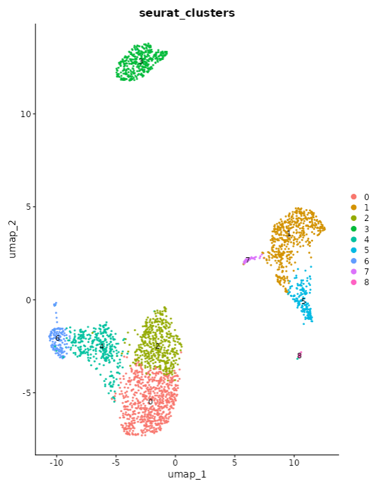
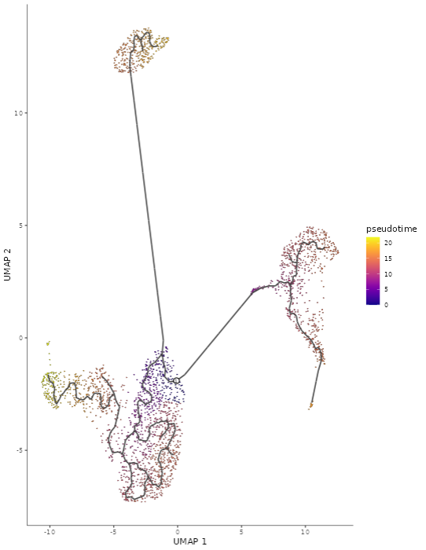
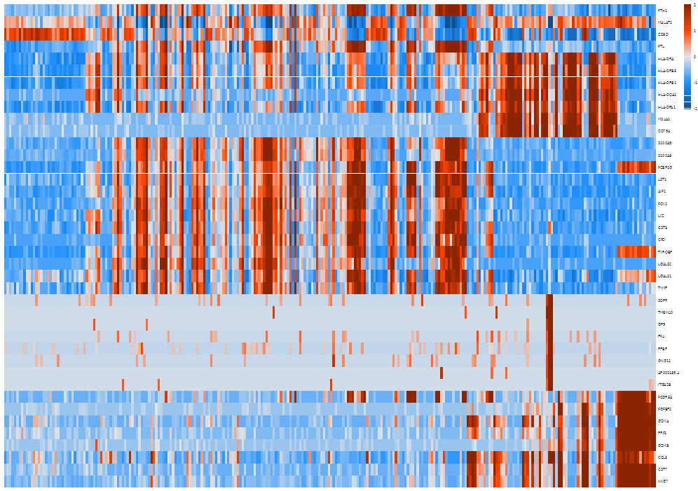

<h3>Order single cells along a trajectory</h3>

Start from a single-cell data set that has already been clustered, choose where the process begins, and see how the cells line up in pseudotime and which genes change along the way. No R programming is needed.

The analysis is run by <a href="https://cole-trapnell-lab.github.io/monocle3/" target="_blank">Monocle 3</a> on a Seurat object.

<h3>How it works</h3>

<h4>1Input data</h4>
Upload a Seurat object and press Load object.

<h4>2Trajectory settings</h4>
Choose the assay, the identity that groups the cells, and a progenitor gene that marks where the trajectory starts. Press Run Monocle3.

<h4>3Results</h4>
The Results tab shows the cells by group, the trajectory coloured by pseudotime, and a heatmap of the genes that change along it.

<h4>4Download</h4>
Download any of the three plots, and the results table as a CSV file.

<h3>What you get</h3>

Figures from an example data set of blood cells. Click a figure to enlarge it.

<figure class="guide-figure"><figcaption><strong>Cells by group</strong> The cells on the UMAP, coloured by the identity you chose.</figcaption></figure>
<figure class="guide-figure"><figcaption><strong>Trajectory</strong> The path through the cells, coloured by pseudotime from the starting point.</figcaption></figure>
<figure class="guide-figure"><figcaption><strong>Genes along the trajectory</strong> Genes significantly associated with pseudotime, with cells ordered along it.</figcaption></figure>

<h3>Preparing your data</h3>
<ul>
<li>A Seurat object saved as an <code>.rds</code> file, or an <code>.RData</code> file. The Seurat app in NASQAR2 exports one.</li>
<li><strong>An <code>.RData</code> file must hold exactly one Seurat object.</strong></li>
<li><strong>The object must already be analysed</strong>: it needs a UMAP and clusters, since the trajectory is drawn on them.</li>
<li><strong>The progenitor gene must be present in the data.</strong> Use a gene that is high in the cells where the process starts.</li>
<li>Arriving from the Seurat app with its hand-off button loads the object for you, with nothing to upload.</li>
</ul>

<h3>On a private instance</h3>

NASQAR2 can also run as a private instance on your own server or cluster, where your data stays on your own machines. Everything above works the same way there. In addition:

<ul>
<li><strong>Large objects need no upload.</strong> Choose <strong>Seurat object in the private space</strong> and press <strong>Browse</strong> to use a file that is already on the server.</li>
<li><strong>Your work is saved automatically</strong> in the project chosen at the top of the input step, for objects read from the private space.</li>
<li><strong>Every analysis belongs to a project.</strong> The <strong>Project</strong> question at the top of the input step asks whether to <strong>create a new project</strong> or <strong>open an existing one</strong>. All applications of one study save into the same project, each in its own folder.</li>
<li><strong>You can continue later.</strong> Choose <strong>Open an existing project</strong>, pick the project and press <strong>Continue</strong>. The settings and the trajectory come back without running it again. <strong>Only projects made from an object in the private space can be reopened.</strong></li>
<li><strong>Your downloads are kept together</strong> on the <strong>Project files</strong> tab.</li>
</ul>

These options do not appear on the public site.

<h3>Citation</h3>

Cao J, Spielmann M, Qiu X, et al. The single-cell transcriptional landscape of mammalian organogenesis. <em>Nature</em> 566, 496-502 (2019). <a href="https://doi.org/10.1038/s41586-019-0969-x" target="_blank">https://doi.org/10.1038/s41586-019-0969-x</a>

<button type="button" class="close" data-dismiss="modal">&times;Close</button>

