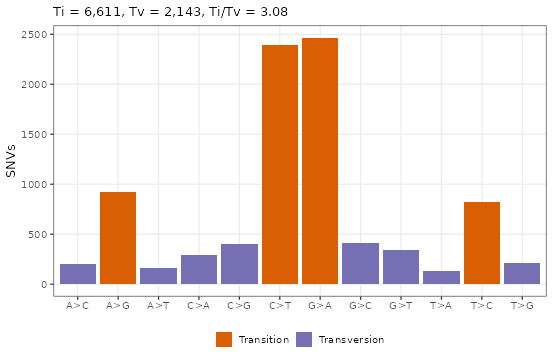
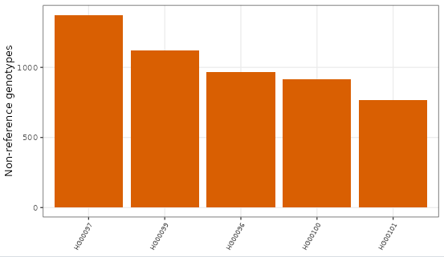

<h3>Annotate the variants of a VCF file</h3>

Load a VCF, keep the variants you trust, and find out where each one falls and what it does to the protein. No R programming is needed.

The annotation is run by the Bioconductor <strong>VariantAnnotation</strong> package against the UCSC gene model of the reference genome you select. Everything runs offline inside NASQAR2; no external service or licence is required.

<h3>How it works</h3>

Each step appears in the sidebar when the one before it has finished.

<h4>1Input data</h4>
Upload a VCF or start from the example, choose the reference genome and load it. The VCF Summary tab then describes the file.

<h4>2Filter variants</h4>
Keep records by FILTER, QUAL, depth and variant type, and restrict to chromosomes, regions or genes.

<h4>3Annotate</h4>
Place every variant on the overlapping transcripts and predict the consequence of the coding ones.

<h4>4Explore and hand off</h4>
Look at the summary plots, download the tables and the filtered VCF, or send the affected genes to enrichment analysis.

<h3>What you get</h3>

Figures from the example VCF (1000 Genomes, chr22). Click a figure to enlarge it.

<figure class="guide-figure"><figcaption><strong>Variant types</strong> How many SNVs, indels and multi-nucleotide variants passed the filters.</figcaption></figure>
<figure class="guide-figure"><figcaption><strong>Genomic location</strong> Coding, splice site, promoter, UTR, intron or intergenic, for every transcript.</figcaption></figure>
<figure class="guide-figure"><figcaption><strong>Predicted effect</strong> The most severe consequence of each variant, from frameshift to intergenic.</figcaption></figure>
<figure class="guide-figure"><figcaption><strong>Substitution spectrum</strong> The twelve base changes and the transition to transversion ratio.</figcaption></figure>
<figure class="guide-figure"><figcaption><strong>Genotypes per sample</strong> Non-reference genotypes in each sample of a multi-sample file.</figcaption></figure>

The Summary Plots tab also shows variants per chromosome and the QUAL and depth distributions. The Downloads tab has the per-variant and per-transcript tables, the gene list and the filtered VCF.

<h3>New to VCF files?</h3>

A VCF lists one variant per line: its chromosome and position, the reference and alternate alleles, a quality score, a FILTER verdict, and optional per-sample genotypes. The app accepts <code>.vcf</code>, <code>.vcf.gz</code> and <code>.vcf.bgz</code> files that are sorted by chromosome and position.

<button type="button" class="close" data-dismiss="modal">&times;Close</button>

## Step by step

### 1. Input Data

**Where is your data?** decides what the tab shows:

* **Upload a VCF file** — one `.vcf`, `.vcf.gz` or `.vcf.bgz` file. Upload the
  matching `.tbi` index in the same step to skip re-indexing.
* **Example VCF** — the chr22 subset of the 1000 Genomes project shipped with
  VariantAnnotation (GRCh37 coordinates, contig name `22`). The hg19
  reference is selected automatically.

Select the **reference genome**. Only genomes whose BSgenome, TxDb and
organism packages are installed appear in the list. When the dbSNP `SNPlocs`
package for that genome is installed, rsIDs are added automatically.

Human hg38 and hg19 ship with NASQAR2. To work with another species, open
**Install another reference genome**, pick it from the catalog (mouse, rat,
zebrafish, fruit fly, nematode, yeast, chicken, pig, cow, dog, rhesus macaque,
chimpanzee) and press **Install**. The packages are downloaded from
Bioconductor in the background and installed into the instance's R library.
The server needs internet access for this. The panel is shown only when the
instance allows installing packages.

Files that are not bgzip-compressed and tabix-indexed are converted once into
a working copy; the source file is never modified. The VCF must be
coordinate-sorted.

Press **Load VCF**. An overview of the file appears next to the form, and the
next steps appear in the sidebar. The sidebar marks each finished step with a
check mark and the step to do next with a **Next** badge.

### 2. VCF Summary

Shows the header (INFO and FORMAT definitions, samples) and the number of
records per contig taken from the tabix index. **Record statistics** stream
through the file once, reading only the fixed columns and `INFO/DP`, and report
variant types, FILTER values and QUAL/DP distributions. Small files are
summarised automatically; for a large file, press the button to start.

### 3. Filter Variants

Choose what to keep, then press **Apply filters**. A line above the button
estimates how many records will be read with the current restriction. When the
run finishes, the **Filter summary** reports how many records were scanned and
kept and the settings that were used.

Record filters:

* **PASS only** keeps records whose FILTER is `PASS` or `.` (no filter applied).
* **Minimum QUAL** and **Minimum INFO/DP** thresholds; records with a missing
  value fail a threshold when one is set.
* **Variant types**: SNV, Indel, MNV, Multiallelic, Other. Multiallelic
  records are split into one row per alternate allele during annotation.
  `Other` covers symbolic alleles such as `<DEL>` or breakends, which cannot be
  annotated and are removed before annotation.

Genomic restriction:

* **Chromosomes**, **regions** (`chr:start-end`, one per line) and **gene
  symbols** (mapped to gene bodies plus a flank). Region and chromosome names
  are converted between `chr1` and `1` styles automatically.

Large files are read piece by piece, and the records that pass the filters are
written straight to a compressed, indexed VCF, so a file of any size can be
filtered. Restricting chromosomes, regions or genes still makes a whole-genome
run much faster.

For files with at most 50 samples the `GT` genotype field is read so that
per-sample counts can be plotted. Larger cohorts are annotated from the fixed
columns only.

### 4. Annotate

* **locateVariants** places every allele on all overlapping transcripts:
  coding, splice site, promoter, 5' UTR, 3' UTR, intron, intergenic. The
  promoter window is configurable.
* **predictCoding** predicts the consequence of every coding allele:
  synonymous, nonsynonymous, nonsense, frameshift, or not translated, with
  reference and variant codons, amino acids and protein position.
* Gene identifiers from the transcript model (Entrez Gene) are mapped to
  symbols with the organism package.
* **dbSNP rsIDs** are added to single-nucleotide variants whose alternate
  allele matches the dbSNP record, whenever the dbSNP package for the genome
  is installed.

Annotation also works through the filtered VCF piece by piece, so a large
file does not run out of memory; it only takes longer. Two tables are
produced:

* **Per variant and transcript**: one row for every allele–transcript pair.
* **Per variant**: one row per allele keeping the most severe effect, with the
  number of transcripts and all overlapping genes.

Press **Annotate variants** to start. The **Annotation report** then gives
the totals: records, alleles annotated, coding alleles and genes with variants.
In the **Annotated variants** table, switch between one row per variant and
one row per variant and transcript, and use the box above each column to
filter it. The table on screen shows the first rows of each; the complete
tables are available under Downloads.

Severity order: frameshift > nonsense > nonsynonymous > splice site > coding
(unpredicted) > not translated > synonymous > promoter > 5' UTR > 3' UTR >
intron > intergenic.

Results are remembered: running the same file with the same settings again is
instant.

### 5. Summary Plots

Variant types, genomic locations, predicted effects, substitution spectrum with
the transition/transversion ratio, variants per chromosome, QUAL and DP
distributions and, for multi-sample files, non-reference genotypes per sample.
Every figure downloads as PNG (300 DPI), PDF or SVG.

### 6. Downloads

Per-variant and per-transcript CSV tables, the gene list, the filter summary
and the filtered records as a bgzip-compressed VCF. The filtered VCF carries
the columns that were read for annotation (fixed fields, `INFO/DP` and `GT` for
files with at most 50 samples).

### 7. Enrichment Handoff

Sends the genes carrying variants to **ClusterProfShinyORA** for GO and KEGG
over-representation analysis. Choose whether to send gene symbols or Entrez
Gene IDs, and whether to include only genes with coding or splice-site
variants; the tab shows how many genes that is. In the ORA app, select the
organism of your reference genome (Human for hg38 or hg19) and set the Keytype
to the identifier you sent (SYMBOL or ENTREZID).

### Reference genomes

| Genome | Sequence | Gene model | dbSNP |
|---|---|---|---|
| hg38 / GRCh38 | BSgenome.Hsapiens.UCSC.hg38 | TxDb.Hsapiens.UCSC.hg38.knownGene | SNPlocs.Hsapiens.dbSNP144.GRCh38 |
| hg19 / GRCh37 | BSgenome.Hsapiens.UCSC.hg19 | TxDb.Hsapiens.UCSC.hg19.knownGene | SNPlocs.Hsapiens.dbSNP144.GRCh37 |

The dbSNP packages ship with NASQAR2. If a deployment omits them, annotation
runs without rsIDs and the report says so.

### Citation

> Obenchain V, Lawrence M, Carey V, Gogarten S, Shannon P, Morgan M.
> VariantAnnotation: a Bioconductor package for exploration and annotation of
> genetic variants. *Bioinformatics* 30(14):2076–2078 (2014).
> https://doi.org/10.1093/bioinformatics/btu168

<h3 style="font-size:20px; font-weight:600; margin:34px 0 6px;">Saving and reopening your work</h3>

On this instance your analysis is saved for you, so you can come back to it later.

<ul>
<li><strong>It is saved automatically</strong> under the name in the <strong>Project name</strong> box on the Input Data tab.</li>
<li><strong>To continue later</strong>, choose <strong>Reopen a saved project</strong> on the Input Data tab, pick your project and press <strong>Open project</strong>. Everything comes back as you left it, without running the analysis again.</li>
<li><strong>To use a file that is already on the server</strong> instead of uploading one, choose <strong>VCF in the private space</strong> and press <strong>Browse</strong>.</li>
<li><strong>Your figures and tables</strong> are collected on the <strong>Project files</strong> page. <strong>Save all to project</strong> stores all of them in one click.</li>
</ul>

