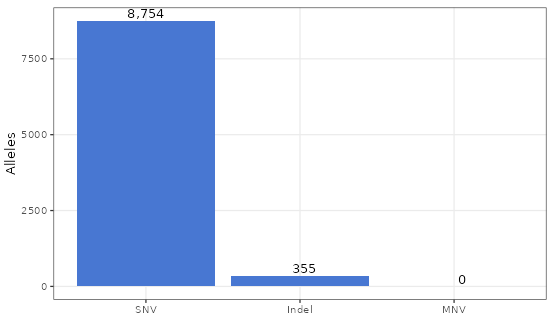
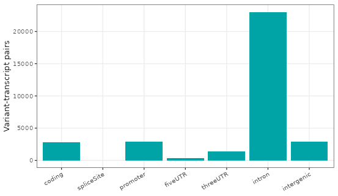
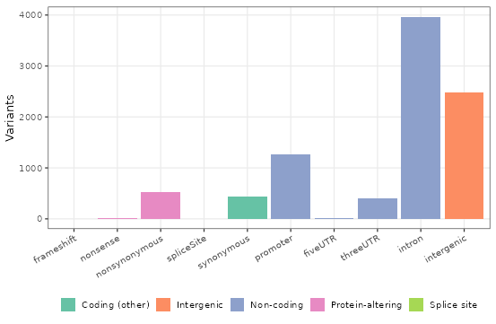

<h3>Annotate the variants of a VCF file</h3>

Load a VCF, keep the variants you trust, and find out where each one falls and what it does to the protein. No R programming is needed.

The annotation is run by the Bioconductor <strong>VariantAnnotation</strong> package against the UCSC gene model of the reference genome you select. Everything runs offline inside NASQAR2; no external service or licence is required.

<h3>How it works</h3>

Each step appears in the sidebar when the one before it has finished.

<h4>1Input data</h4>
Upload a VCF or start from the example, choose the reference genome and load it. The VCF Summary tab then describes the file.

<h4>2Filter variants</h4>
Keep records by FILTER, QUAL, depth and variant type, and restrict to chromosomes, regions or genes.

<h4>3Annotate</h4>
Place every variant on the overlapping transcripts and predict the consequence of the coding ones.

<h4>4Explore and hand off</h4>
Look at the summary plots, download the tables and the filtered VCF, or send the affected genes to enrichment analysis.

<h3>What you get</h3>

Figures from the example VCF (1000 Genomes, chr22). Click a figure to enlarge it.

<figure class="guide-figure"><figcaption><strong>Variant types</strong> How many SNVs, indels and multi-nucleotide variants passed the filters.</figcaption></figure>
<figure class="guide-figure"><figcaption><strong>Genomic location</strong> Coding, splice site, promoter, UTR, intron or intergenic, for every transcript.</figcaption></figure>
<figure class="guide-figure"><figcaption><strong>Predicted effect</strong> The most severe consequence of each variant, from frameshift to intergenic.</figcaption></figure>
<figure class="guide-figure"><figcaption><strong>Substitution spectrum</strong> The twelve base changes and the transition to transversion ratio.</figcaption></figure>
<figure class="guide-figure"><figcaption><strong>Genotypes per sample</strong> Non-reference genotypes in each sample of a multi-sample file.</figcaption></figure>

The Summary Plots tab also shows variants per chromosome and the QUAL and depth distributions. The Downloads tab has the per-variant and per-transcript tables, the gene list and the filtered VCF.

<h3>New to VCF files?</h3>

A VCF lists one variant per line: its chromosome and position, the reference and alternate alleles, a quality score, a FILTER verdict, and optional per-sample genotypes. The app accepts <code>.vcf</code>, <code>.vcf.gz</code> and <code>.vcf.bgz</code> files that are sorted by chromosome and position.

<button type="button" class="close" data-dismiss="modal">&times;Close</button>

## Step by step

### 1. Input Data

**Where is your data?** decides what the tab shows:

* **Upload a VCF file** — one `.vcf`, `.vcf.gz` or `.vcf.bgz` file. Upload the
  matching `.tbi` index in the same step to skip re-indexing.
* **Example VCF** — the chr22 subset of the 1000 Genomes project shipped with
  VariantAnnotation (GRCh37 coordinates, contig name `22`). The hg19
  reference is selected automatically.

<strong>On this private instance</strong> there are two more choices and your work is kept as a project.

<ul>
<li><strong>VCF in the private space</strong>: a VCF already on the server, chosen with <strong>Browse</strong>. It is read in place; nothing is uploaded.</li>
<li><strong>Reopen a saved project</strong>: pick a project and press <strong>Open project</strong>. The loaded VCF, the reference genome, the filters and the annotation results come back in seconds, without recomputing. A project is not reopened when its source VCF changed since it was made.</li>
</ul>

Every run belongs to a project, named in the <strong>Project name</strong> box. It keeps the indexed VCF, the filtered VCF, the annotation tables, their caches and the settings you used, so the analysis can be reopened later. Figures and tables you download are kept in the project too. The <strong>Project files</strong> page lists them with a preview, and its <strong>Save all to project</strong> button writes every figure and table that exists at that moment into the project without downloading them.

Select the **reference genome**. Only genomes whose BSgenome, TxDb and
organism packages are installed appear in the list. When the dbSNP `SNPlocs`
package for that genome is installed, rsIDs are added automatically.

Human hg38 and hg19 ship with NASQAR2. To work with another species, open
**Install another reference genome**, pick it from the catalog (mouse, rat,
zebrafish, fruit fly, nematode, yeast, chicken, pig, cow, dog, rhesus macaque,
chimpanzee) and press **Install**. The packages are downloaded from
Bioconductor in the background and installed into the instance's R library.
The server needs internet access for this. The panel is shown only when the
instance allows installing packages.

Files that are not bgzip-compressed and tabix-indexed are converted once into
a working copy; the source file is never modified. The VCF must be
coordinate-sorted.

### 2. VCF Summary

Shows the header (INFO and FORMAT definitions, samples) and the number of
records per contig taken from the tabix index. **Record statistics** stream
through the file once, reading only the fixed columns and `INFO/DP`, and report
variant types, FILTER values and QUAL/DP distributions. Files with fewer
records than the chunk size are summarised automatically; larger files start on
request.

### 3. Filter Variants

Record filters:

* **PASS only** keeps records whose FILTER is `PASS` or `.` (no filter applied).
* **Minimum QUAL** and **Minimum INFO/DP** thresholds; records with a missing
  value fail a threshold when one is set.
* **Variant types**: SNV, Indel, MNV, Multiallelic, Other. Multiallelic
  records are split into one row per alternate allele during annotation.
  `Other` covers symbolic alleles such as `<DEL>` or breakends, which cannot be
  annotated and are removed before annotation.

Genomic restriction:

* **Chromosomes**, **regions** (`chr:start-end`, one per line) and **gene
  symbols** (mapped to gene bodies plus a flank). Region and chromosome names
  are converted between `chr1` and `1` styles automatically.

Large files are read in tiles or streamed in chunks (`NASQAR_VARIANT_YIELD_SIZE`,
default 100,000 records). Records that pass the filters are not held in
memory: they are written straight to a bgzip-compressed, tabix-indexed VCF on disk,
so any number of records can be kept. Restricting
chromosomes, regions or genes still makes a whole-genome run much faster.

For files with at most 50 samples the `GT` genotype field is read so that
per-sample counts can be plotted. Larger cohorts are annotated from the fixed
columns only.

### 4. Annotate

* **locateVariants** places every allele on all overlapping transcripts:
  coding, splice site, promoter, 5' UTR, 3' UTR, intron, intergenic. The
  promoter window is configurable.
* **predictCoding** predicts the consequence of every coding allele:
  synonymous, nonsynonymous, nonsense, frameshift, or not translated, with
  reference and variant codons, amino acids and protein position.
* Gene identifiers from the transcript model (Entrez Gene) are mapped to
  symbols with the organism package.
* **dbSNP rsIDs** are added to single-nucleotide variants whose alternate
  allele matches the dbSNP record, whenever the dbSNP package for the genome
  is installed.

Annotation streams the filtered VCF in chunks (`NASQAR_VARIANT_ANNOTATION_CHUNK`,
default 50,000 records), so memory use depends on the chunk size rather than
on the number of filtered variants; a cohort-sized VCF annotates in bounded
memory, it only takes longer. Two tables are produced and written to disk
as CSV while the run proceeds:

* **Per variant and transcript**: one row for every allele–transcript pair.
* **Per variant**: one row per allele keeping the most severe effect, with the
  number of transcripts and all overlapping genes.

The interactive table shows the first 10,000 rows of each
(`NASQAR_VARIANT_TABLE_PREVIEW`); the complete tables are available under
Downloads.

Severity order: frameshift > nonsense > nonsynonymous > splice site > coding
(unpredicted) > not translated > synonymous > promoter > 5' UTR > 3' UTR >
intron > intergenic.

Results are cached. The cache key covers the VCF path,
size and modification time, all filter and annotation settings, and the versions
of VariantAnnotation and the genome packages, so re-running the same settings is
instant.

### 5. Summary Plots

Variant types, genomic locations, predicted effects, substitution spectrum with
the transition/transversion ratio, variants per chromosome, QUAL and DP
distributions and, for multi-sample files, non-reference genotypes per sample.
Every figure downloads as PNG (300 DPI), PDF or SVG.

### 6. Downloads

Per-variant and per-transcript CSV tables, the gene list, the filter summary
and the filtered records as a bgzip-compressed VCF. The filtered VCF carries
the columns that were read for annotation (fixed fields, `INFO/DP` and `GT` for
files with at most 50 samples).

### 7. Enrichment Handoff

The genes carrying variants (optionally only coding or splice-site variants)
are written to the NASQAR2 exchange area and opened in **ClusterProfShinyORA**.
In the ORA module select the organism Human and set the Keytype to the
identifier you transferred (SYMBOL or ENTREZID).

### Reference genomes

| Genome | Sequence | Gene model | dbSNP |
|---|---|---|---|
| hg38 / GRCh38 | BSgenome.Hsapiens.UCSC.hg38 | TxDb.Hsapiens.UCSC.hg38.knownGene | SNPlocs.Hsapiens.dbSNP144.GRCh38 |
| hg19 / GRCh37 | BSgenome.Hsapiens.UCSC.hg19 | TxDb.Hsapiens.UCSC.hg19.knownGene | SNPlocs.Hsapiens.dbSNP144.GRCh37 |

The dbSNP packages ship with NASQAR2. If a deployment omits them, annotation
runs without rsIDs and the report says so.

### Citation

> Obenchain V, Lawrence M, Carey V, Gogarten S, Shannon P, Morgan M.
> VariantAnnotation: a Bioconductor package for exploration and annotation of
> genetic variants. *Bioinformatics* 30(14):2076–2078 (2014).
> https://doi.org/10.1093/bioinformatics/btu168
